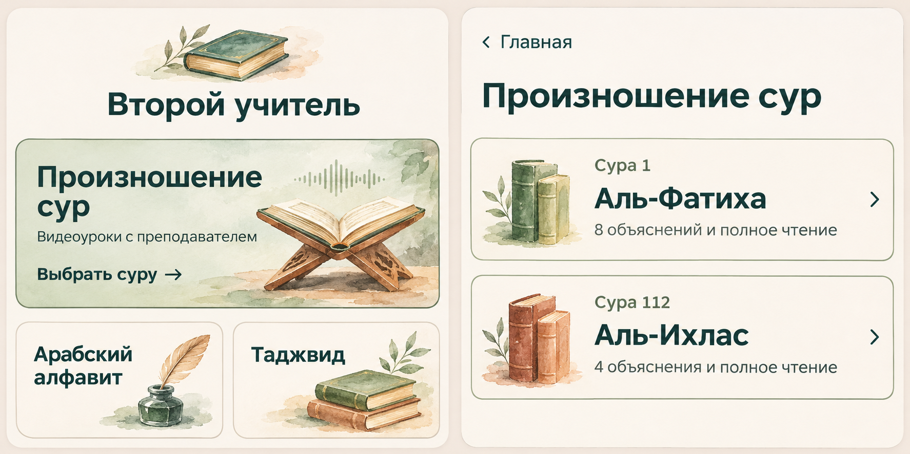
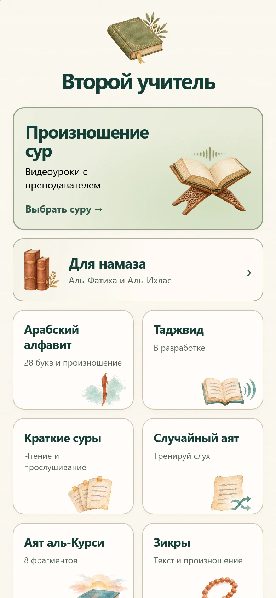
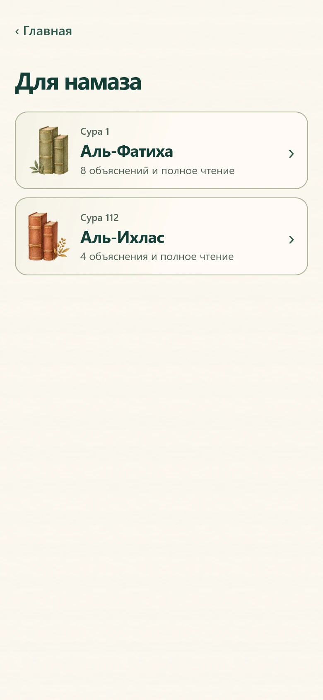
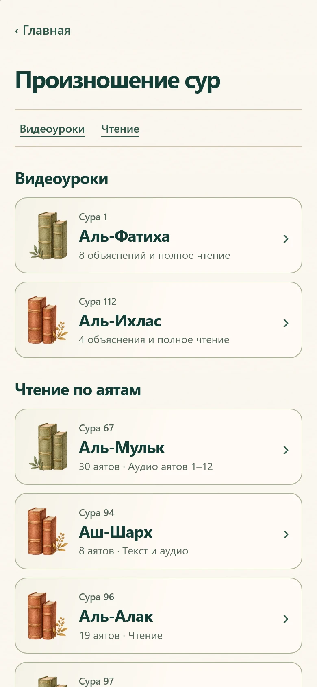

# Дизайн «Второго учителя»

Акварельный стиль принят для дальнейшего развития приложения. При добавлении раздела или учебного материала используем общую палитру, иллюстрации и компоненты сайта. Согласованный макет задаёт визуальный стиль, а снимки ниже показывают, как он применяется в действующем интерфейсе.

## Основные экраны

| Главная | Для намаза | Произношение сур |
| --- | --- | --- |
|  |  |  |

Снимки сделаны в мобильном WebKit при ширине 390 и высоте 844 CSS-пикселя. Они показывают первый экран каждого раздела.

| Раздел | Снимки |
| --- | --- |
| Урок с преподавателем | [Список фрагментов](screens/lesson-list.webp) · [Видеоплеер](screens/lesson-player.webp) |
| Чтение сур | [Список сур](screens/surahs.webp) · [Чтение по аятам](screens/reader.webp) |
| Буквы и произношение | [Алфавит](screens/alphabet.webp) · [Карточка буквы](screens/letter.webp) · [Таджвид](screens/tajweed.webp) |
| Случайный аят | [Выбор сур](screens/random-setup.webp) · [Прослушивание](screens/random-play.webp) |
| Другие материалы | [Аят аль-Курси](screens/kursi.webp) · [Зикры](screens/dhikr.webp) |

## Как оформить следующий материал

- **Главная.** У крупного раздела одна карточка-вход. Вверху находится «Произношение сур», под ним — самостоятельный вход «Для намаза». Новые материалы для намаза добавляем внутри этого раздела. Сейчас в нём Аль-Фатиха и Аль-Ихлас. Ат-Ташахуд и Салават отложены до отдельного решения об их добавлении. [Разметка главной](../../index.html) · [Раздел для намаза](../../pages/namaz.html)
- **Список.** Вся строка с классом `library-card` служит ссылкой. Слева находится акварельная иллюстрация, в центре — название и доступный формат, справа — стрелка. Для суры указываем её номер, для видео — число объяснений и наличие полного чтения. [Каталог](../../pages/pronunciation.html) · [Формирование карточек](../../js/pages/surah-catalog.js)
- **Урок.** Оформление обрамляет учебный материал. Арабский текст, огласовки и преподаватель должны быть видны полностью. В плеере сохраняем повтор, перемотку и возврат к списку, из которого открыли урок. [Пример урока](../../pages/al-ikhlas.html)
- **Изображения и шрифт.** Для интерфейса используем системный шрифт устройства. Заголовок и действие остаются текстом страницы. Декоративные акварели подключаем в WebP с пустым `alt`. Иллюстрации хранятся отдельно от сканов для чтения. [Акварельные материалы](../../assets/images/watercolor)

## Цвета

| Назначение | Цвет | Переменная CSS |
| --- | --- | --- |
| Бумажный фон | `#FAF6EE` | `--paper` |
| Заголовки и основной текст | `#153E38` | `--ink` |
| Ссылки и основные действия | `#31594C` | `--teal` |
| Второстепенный текст | `#53645A` | `--muted` |
| Терракотовый акцент и обводка фокуса | `#965235` | `--clay` |
| Граница карточки | `#CFC4AE` | `--line` |

Для следующей страницы подключаем общую таблицу стилей. В ней заданы размеры карточек, отступы, типографика, переносы и состояния кнопок. [Стили интерфейса](../../css/watercolor.css)
